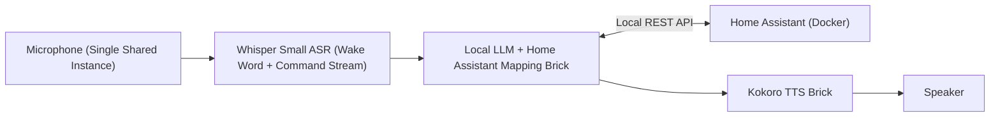

# Project Requirements: Smart Home Assistant with Local AI on Arduino Ventuno Q

## 1. Project Overview
Build a privacy-first, locally hosted smart home voice assistant running on an **Arduino Ventuno Q**. The system combines **Home Assistant** for device automation with a local voice pipeline (**Whisper Small Wake-Word & ASR + Local LLM + Kokoro TTS**) built in **Arduino App Lab**, enabling natural-language voice commands to control smart home devices without relying on cloud services.

---

## 2. System Architecture

### Hardware
- **Compute Platform:** Arduino Ventuno Q
- **Audio Input/Output:** Single shared USB Microphone (for Whisper wake-word detection & voice commands) and speaker (for TTS responses)

### Software Stack
- **Home Automation Hub:** Home Assistant running locally in a Docker container on the Ventuno Q
- **AI & Voice Pipeline (Arduino App Lab):**
  - Evolved from the [`keyword-asr-local-llm-kokoro-tts`](https://docs.arduino.cc/tutorials/ventuno-q/local-ai-assistant/) application architecture
  - **Architectural Decision (Whisper Small over Keyword Spotting):** Instead of using a separate `KeywordSpotting` TinyML model (which suffered from false positives and required dual-microphone/session switching overhead), the system uses **Whisper Small (`whisper-small-quantized`)** via the `AutomaticSpeechRecognition` (`arduino:asr`) brick in a single continuous streaming session for both wake-word detection (`WAKE_WORD="Hey Arduino"`, including phonetic variants and inline commands) and command transcription.
  - Combines the `arduino:asr` and `arduino:llm` Bricks with custom `home_assistant_mapping` and `kokoro_tts` Bricks.

---

## 3. Functional Requirements

### 3.1 Home Assistant Core
- [x] Run Home Assistant locally inside a Docker container on the Arduino Ventuno Q.
- [x] Expose local API endpoints (REST API / WebSocket API / Long-Lived Access Token) for local inter-container communication.

### 3.2 Voice Input & Speech-to-Text (Whisper Small Wake Word & ASR)
- [x] Use **Whisper Small (`whisper-small-quantized`)** directly instead of a dedicated `KeywordSpotting` model to eliminate false wake-word triggers.
- [x] Continuously listen for the configurable wake word (`WAKE_WORD` in `.env`, default `"Hey Arduino"`) and seamlessly transition into command capture within the same ASR stream (or immediately execute inline commands spoken in the same breath as the wake word).
- [x] Transcribe spoken user commands locally into text using a single `Microphone` instance shared with the `AutomaticSpeechRecognition` brick.

### 3.3 Custom Local LLM Brick (Home Assistant Integration)
- [ ] Base the custom brick on the `keyword-asr-local-llm-kokoro-tts` LLM pipeline.
- [ ] Provide the LLM with context of available Home Assistant entities, states, and services (e.g., lights, switches, sensors, climate).
- [ ] Parse user intent and execute commands against the local Home Assistant instance (via tool calling / structured JSON output / Home Assistant REST API).
- [ ] Return a concise natural-language confirmation or status response to be spoken aloud.
- [ ] Support general-knowledge and conversational queries when the user's prompt does not target a smart home device.
- [ ] Log transcribed user prompts, triggered Home Assistant tool calls/commands, and generated LLM responses to the console (`stdout`) for real-time debugging and observability.

### 3.4 Text-to-Speech (TTS)
- [ ] Synthesize the LLM's response into speech locally using the `kokoro_tts` Docker container/brick.
- [ ] Play the generated audio response back to the user with low latency.

---

## 4. Non-Functional Requirements
- **100% Local Execution:** Voice recognition, LLM inference, TTS synthesis, and Home Assistant control must operate on the local network/device without external cloud dependencies.
- **Reproducible Deployment:** Custom brick containers must be buildable and deployable on the Ventuno Q (`~/ArduinoApps`).
- **Low Latency:** Keep prompts, tool definitions, and TTS responses concise to minimize end-to-end voice response time on edge hardware.